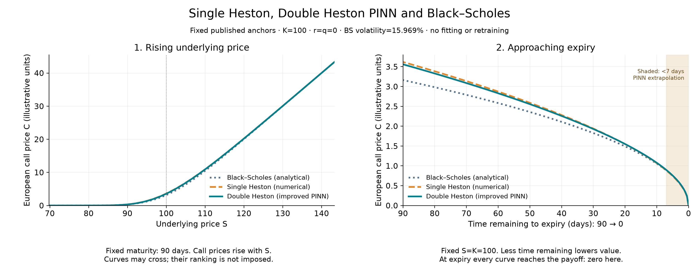

# Requested model curves

Branch `codex/improved-double-heston-pinn`, commit `f4bc4929195d5d0dd35c241677b5928fd591a39d`. No retraining or market data used.

## Interpretation

1. The horizontal axis is underlying price, not calendar time or an observed market path. All three call-price curves increase and are convex on this grid at fixed 90-day maturity.
2. The second horizontal axis deliberately runs from 90 days remaining to zero. With S=K=100 and r=q=0 held fixed, prices fall toward the zero terminal payoff. If tau instead increased left to right, these same maturity curves would rise. The 0<tau<7-day PINN region is explicitly extrapolation; tau=0 is its exact payoff construction.

## What Black–Scholes consistency means

Shared call bounds, spot monotonicity, convexity, terminal payoff and the appropriate constant-variance limit—not identical prices or a predetermined DH>SH>BS ranking. Spot, rates and variance inputs are fixed on the time slice; a real market path need not decline smoothly.

SH uses the branch's Fourier pricer, DH uses its selected ARCH_A_MODIFIED_MLP two-seed PINN, and BS uses the analytical formula. The DH numerical price is separately computed for error checks. These are not three PINNs or a new out-of-sample accuracy test.

## Parameters and provenance

[Chang, Wang & Zhang (2021), Table 1](https://doi.org/10.1155/2021/6634779) supplies the unchanged ordinary Heston/DH anchors, originally DJIA ETF values—not Bitcoin parameters. Order per factor is kappa,theta,sigma,rho,v0. SH=[8.9814, 0.0409, 0.297, -0.9621, 0.0244]; DH slow/fast=[0.9491, 0.0257, 0.0517, 0.7009, 0.0003, 10.7526, 0.033, 0.3613, -0.8916, 0.0252]. BS sigma=sqrt(DH initial total variance)=0.1596871942. K=100; r=q=0. SH and DH retain their own published variances; differences are scenario-specific, not a ranking of accuracy.

Numerical check details and every plotted value are in [results.json](results.json). No line offsets, target-based parameter selection, clipping, or smoothing was applied.

Reproduce from this checkout with `../.venv/bin/python -m experiments.sketch_model_curves.plot`.
